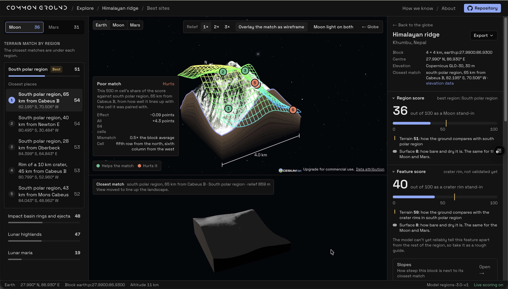

# Common Ground


<!-- screenshot goes here -->

Click a spot on Earth and see how much the ground there looks like the Moon or Mars, and why.

Built for NASA Space Apps 2026.

## What it does

Astronauts and rovers get tested on Earth before they go, in places like Meteor Crater, Iceland and the Atacama. Those places get picked because they look and feel like the real thing. Common Ground tries to put a number on that.

- Click any land on the globe. The app cuts out a 4 km block there and scores it against regions of the Moon and Mars, 0 to 100.
- It shows the closest match on the other world next to your block, in 3D, and you can lay the match over your block as a wireframe to see where the shapes line up.
- Numbered points on the block mark the 500 m cells that helped or hurt the score most.
- The score is split into the landscape (shape of the ground) and conditions (land cover, things like farmland or trees that a real test site wouldn't want).
- Compare puts up to four blocks side by side with one shared camera, a slope chart and a table of measurements.
- Each result exports as a field sheet PDF, a CSV of scores, or the full JSON.

## How it works

- **Earth terrain** comes from Copernicus GLO-30 (30 m) and land cover from ESA WorldCover 2021. Both are read live from public AWS buckets for each click. No Earth terrain is stored.
- **Moon and Mars terrain** (LOLA, Kaguya, MOLA–HRSC and CTX) is processed once, offline, into the model file. Nothing is downloaded from the Moon or Mars datasets when you click.
- **The model** describes each block with terrain features (relief, roughness, slopes, craters and depressions, ridges) at a few scales, then compares those to every region and landing site in its library.
- New scores are cached in Supabase, so a place someone already clicked opens instantly.

## Repo

| Folder | What's in it |
| --- | --- |
| `web/` | Next.js site. Cesium for the globe, react-three-fiber for the 3D blocks |
| `api/` | FastAPI server that scores a block |
| `ml/` | Notebooks that build the model, plus `ml/export/`, which the API loads directly |

## Run it locally

You need Node 20+ and Python 3.12 with [uv](https://docs.astral.sh/uv/).

API:

```bash
cd api
cp .env.example .env    # set MODEL_PATH to ml/export/model.npz
uv sync
uv run uvicorn app.main:app --reload --port 8000
```

Site:

```bash
cd web
cp .env.example .env.local
npm install
npm run dev             # http://localhost:3000
```

Without the API running, the site still opens places that were scored before (from Supabase) but can't score new ones.

Checks: `npm run lint`, `npm run typecheck` and `npm test` in `web/`, and `uv run pytest` in `api/`.

## Data credits

- Copernicus GLO-30 DEM, ESA / Airbus
- ESA WorldCover 2021
- LOLA global and polar DEMs, NASA GSFC (Barker et al.)
- Kaguya (SELENE) terrain, JAXA
- MOLA–HRSC blended DEM, NASA / ESA / DLR
- CTX DTMs, USGS Astrogeology
- NASA Blue Marble via GIBS, Cesium World Terrain
- Loader photos: NASA, public domain

## Team

<!-- names here -->
